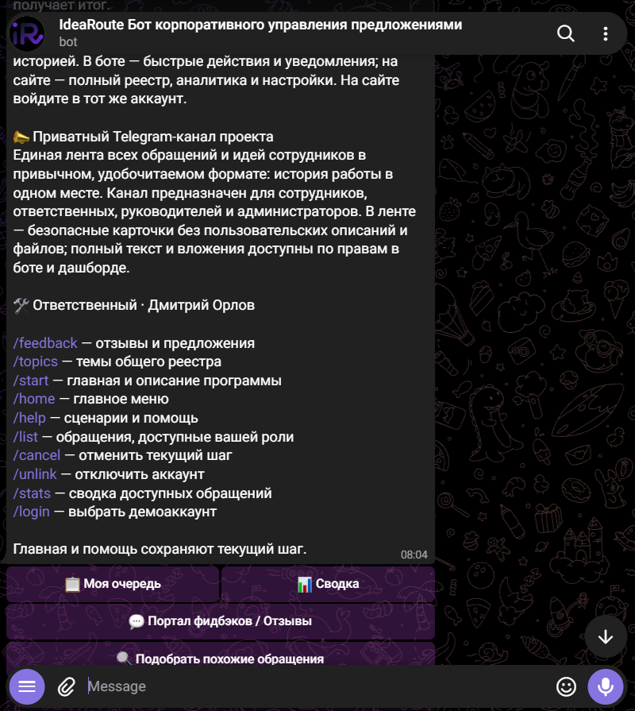
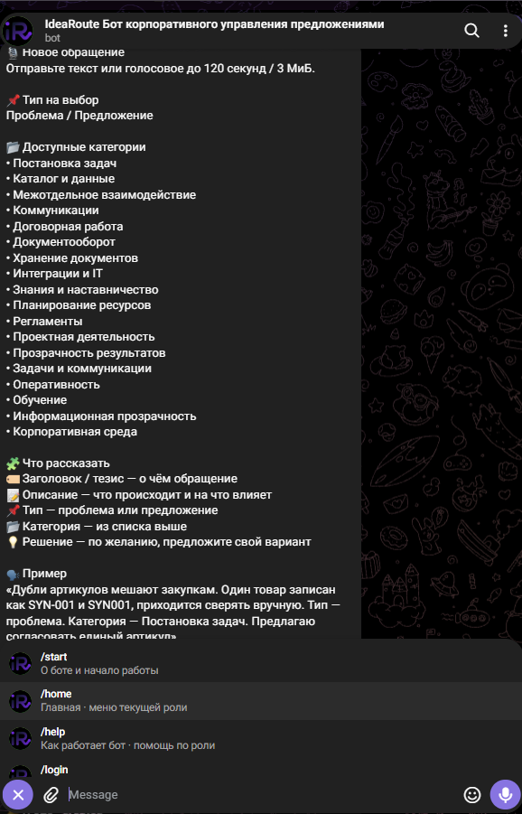
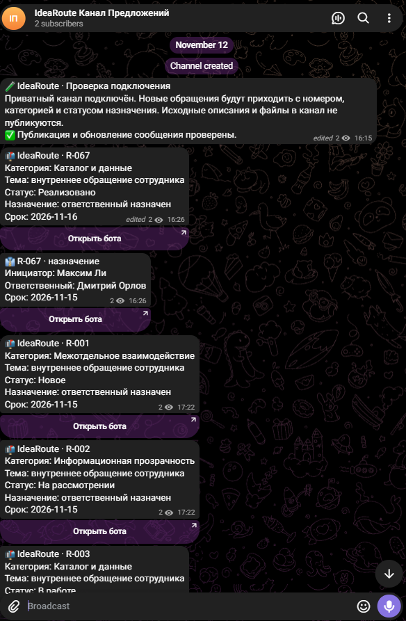
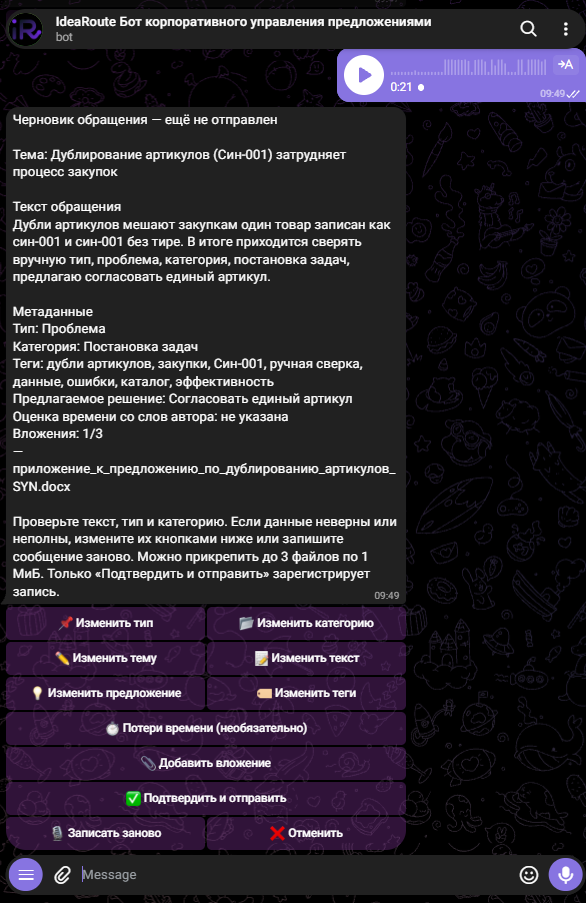
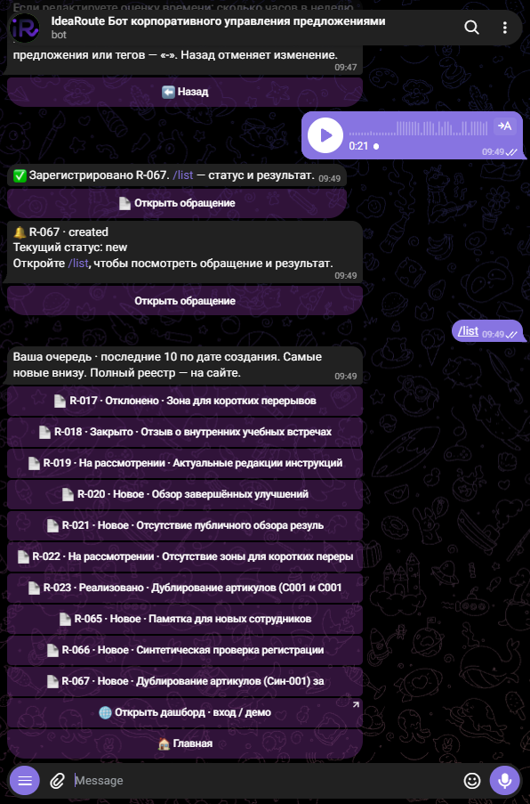
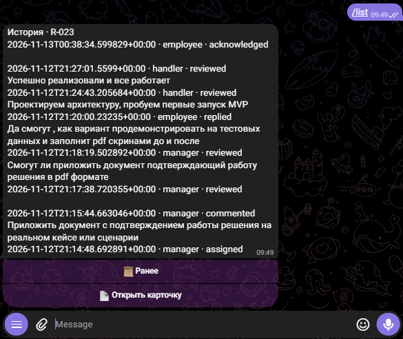

<p align="center"></p>
<h1 align="center">IdeaRoute</h1>
<p align="center"><strong>IdeaRoute · У каждой идеи есть ответственный. У каждого обращения — результат.</strong></p>
<p align="center">


</p>

Для **ГК «Модус Трейд»**: единый путь проблем и предложений сотрудников — от сообщения в вебе или Telegram до решения и обратной связи. Продажи, закупки, проектирование, IT и сервис видят, кто отвечает и что дальше. Предложения перестают теряться в чатах и почте, а повторные сбои становятся видимыми темами для улучшения.

> **IdeaRoute** — система обратной связи и предложений сотрудников. Демо использует синтетические данные. Экономический эффект — гипотеза для пилота, не измеренный результат компании.

## Два сценария ИИ: помощник подачи и Qvin

**Помощник помогает сотруднику оформить мысль. Qvin помогает руководителю разобраться в обращениях и оценить возможный эффект улучшений.**

| | Помощник подачи | Qvin · аналитик IdeaRoute |
|---|---|---|
| Когда нужен | До регистрации обращения | При рассмотрении карточки и анализе реестра |
| Что делает | Из описания предлагает тему, категорию, тип, теги и черновик; сотрудник проверяет и подтверждает отправку | Описывает текущее и предлагаемое состояние, оценивает потенциальную экономию времени и отвечает на вопросы по доступной выборке со ссылками на ID карточек |
| Пример | «Один датчик записан под двумя артикулами» → подготовленная карточка для проверки автором | «Какие проблемы с номенклатурой повторяются и где стоит проверить возможную экономию времени?» → разбор по выбранным обращениям |
| Результат | Понятное обращение для ответственного | Основание для обсуждения приоритетов и следующего шага |

У **Qvin два режима**: структурированная оценка отдельной карточки с источником и допущениями и диалог по реестру в вебе или Telegram. Он различает оценку автора, сценарную гипотезу и отсутствие данных; без подтверждённых ставок и затрат деньги и ROI не рассчитываются. Решение и изменение статуса остаются за человеком.

Технически это **два прикладных сценария поверх общего AI-провайдера**, которые могут использовать одну языковую модель. Qvin получает контекст проекта — разрешённые обращения и оценки эффекта; его выводы ограничены этой выборкой. Распознавание голоса Whisper отдельно превращает речь в текст для проверки. [Подробнее об оценке эффекта и режимах Qvin](docs/PRODUCT-EXPANSION.md#два-режима-qvin).

## Жюри: откройте готовое демо

**[Открыть IdeaRoute → https://kinetria-ai.vercel.app](https://kinetria-ai.vercel.app)** · **[Сразу выбрать роль](https://kinetria-ai.vercel.app/login)**

> Скачивать репозиторий и устанавливать Docker для демонстрации не нужно. Веб-приложение уже размещено на Vercel, подключены база, демоаккаунты и AI. Выберите сотрудника, руководителя или администратора и пройдите сценарий. Для Telegram откройте **[бота IdeaRoute](https://t.me/VoiceChatGpt_Custom_bot)** и отправьте `/start`. Новый зритель выбирает демороль сразу в боте; ссылка из веба не нужна. Если роль уже выбрана, открывается её кабинет. `/login` меняет демоаккаунт.

Несколько зрителей могут выбрать один демоаккаунт: обращения общие, черновики каждого Telegram раздельные. Бот и веб используют одну карточку. **[Вступить в канал компании](https://t.me/+SN0L5X4t6RkzZWJi)** · [открыть канал в Telegram Web](https://web.telegram.org/k/#-4328792903). По плану в канале участвуют все внутренние роли: сотрудники, ответственные, руководители и администраторы. Участие в канале не заменяет аккаунт и не расширяет права. [Краткая инструкция жюри и диагностика](docs/JUDGES_GUIDE.md). Локальная установка ниже нужна только для самостоятельного запуска исходников.

[Запустить ↓](#setup) · [6 сценариев](#scenarios) · [Tender Brief](docs/TENDER_BRIEF.md) · [Audit](docs/TENDER_AUDIT.md) · [Architecture](docs/02-architecture.md) · **[Roadmap: сделано → зачем → дальше](docs/ROADMAP.md)**

## Продукт в действии

Записи Playwright: рабочий веб и локальная PostgreSQL. **AI-ответы детерминированы; Telegram — интерактивный стенд с настоящим обработчиком бота и SQL, внешние Telegram API/Whisper заменены.** Это не запись web.telegram.org. В разделе 4 — шесть настоящих скриншотов: меню, инструкция и канал, затем черновик с файлом, регистрация и история решения. [Методика, проверки и ограничения](docs/DEMO_RECORDING.md).

GIF сохранены в исходных **25 FPS** с единой палитрой **256 цветов**. Для чтения мелкого текста откройте изображение в полном размере; паузы исходных сценариев сохранены.

### 1 · От сообщения к карточке и Qvin


### 2 · Ответственный → уточнение → решение → автор


### 3 · Разрозненные жалобы → сохраняемая тема


### 4 · Telegram: личный бот и общий канал

**Настоящий Telegram:** сотрудник или ответственный работает в личном боте, а команда следит за движением обращений в общем канале. Скриншоты предоставлены пользователем; это не симулятор. Нажмите на изображение, чтобы открыть его целиком.

<table>
  <tr>
    <td align="center" valign="top" width="33%">
      <strong>1. Меню роли</strong><br/>
      <a href="docs/demos/telegram-bot-menu.png"></a><br/>
      Личная очередь, сводка и действия своей роли.
    </td>
    <td align="center" valign="top" width="33%">
      <strong>2. Подача обращения</strong><br/>
      <a href="docs/demos/telegram-request-submission.png"></a><br/>
      Текст или голос → проверка черновика → подтверждение.
    </td>
    <td align="center" valign="top" width="33%">
      <strong>3. Канал компании</strong><br/>
      <a href="docs/demos/telegram-company-channel.png"></a><br/>
      Общая лента для сотрудников, ответственных, руководителей и администраторов.
    </td>
  </tr>
</table>

В канале видны номер обращения, категория, назначение, срок и статус; отдельное событие показывает передачу ответственному. Пользовательские описания и файлы в канал не публикуются. Кнопка «Открыть бота» возвращает к работе с карточкой в рамках прав аккаунта.

**Канал компании:** [приглашение](https://t.me/+SN0L5X4t6RkzZWJi) · [Telegram Web](https://web.telegram.org/k/#-4328792903). Внутренним ролям предлагается вступить в общую служебную ленту; полный текст и действия доступны в личном боте по правам.

**Подача и результат — как это выглядит в боте**

<table>
  <tr>
    <td align="center" valign="top" width="33%">
      <strong>1. Проверить черновик</strong><br/>
      <a href="docs/demos/telegram-request-draft-attachment.png"></a><br/>
      Голос → текст и поля карточки. DOCX уже приложен; отправка требует подтверждения автора.
    </td>
    <td align="center" valign="top" width="33%">
      <strong>2. Получить номер и статус</strong><br/>
      <a href="docs/demos/telegram-request-registered-list.png"></a><br/>
      R-067 зарегистрирован. В /list видны последние обращения, статусы и кнопки открытия карточек.
    </td>
    <td align="center" valign="top" width="33%">
      <strong>3. Прочитать историю решения</strong><br/>
      <a href="docs/demos/telegram-request-history-resolution.png"></a><br/>
      Назначение → обсуждение → сообщение о реализации → ознакомление автора. События сохранены с ролями и датами.
    </td>
  </tr>
</table>

Первые два снимка показывают новую подачу **R-067**; история на третьем относится к ранее реализованному **R-023** из списка. Нажмите на нужный снимок для чтения в полном размере.

**Автоматизированная запись E2E:** следующий GIF показывает интерактивный стенд с настоящим backend и подменой внешних Telegram API/Whisper.


### 5 · Управленческий обзор и маршрутизация


### Дополнительно · Администратор меняет правила маршрутизации


Категория → выбранный руководитель → сохранение правила → новое обращение получает этого владельца. Изменение правила не переназначает уже зарегистрированные карточки задним числом.

<a id="problem"></a>
## Зачем это компании

ГК «Модус Трейд» занимается инженерными и слаботочными системами безопасности. Один и тот же вопрос о номенклатуре, согласовании или сервисе может возвращаться между подразделениями. Без общего реестра до предложений не доходят руки, решения не сохраняются, сотрудники повторяют ручную работу — компания теряет время и деньги.

| Сегодняшняя проблема | Что меняет IdeaRoute |
|---|---|
| Сообщение затерялось в чате/почте | Подтверждённая регистрация, R-номер, история |
| «Кто этим займётся?» | Категория → ответственный + срок; без маршрута — резерв |
| Контекст разбросан по переписке | Материалы, уточнение и ответ в одной карточке |
| Автор не знает, что решили | Письменный итог, уведомление и отдельное ознакомление |
| Одинаковая проблема возникает снова | Теговая аналитика, AI-темы, Qvin по доступной выборке |

<a id="scenarios"></a>
## Шесть основных сквозных сценариев

Это шесть основных путей, которые удобно выделить для демонстрации. Возможности системы ими не ограничены: администратор также настраивает категории, сроки и правила передачи обращений руководителям.

| № | Путь и участвующие экраны | Результат и граница |
|---|---|---|
| 1 | `/login` → сотрудник → «Новое обращение» → ручной/AI-черновик, голос, вложение → подтверждение → Drawer в реестре; руководитель/администратор → Qvin | Одна сохранённая карточка; AI помогает структурировать. Qvin анализирует, но не принимает решения и не гарантирует предотвращение дублей |
| 2 | «Обзор» → «Реестр»/канбан → Drawer руководителя/ответственного → рассмотрение → работа/уточнение → ответ сотрудника → решение → «Результаты»/уведомления автора | Решение и история, отдельная кнопка ознакомления. `implemented` / `rejected` / `closed` — финалы; отдельного статуса «Решено» нет |
| 3 | Реестр рабочей роли → поиск/фильтр → «Выбрать группу похожих обращений» → «✨ Сгенерировать тему с ИИ» → явное сохранение → «Повторяющиеся темы» | Сохранённая группа ID доступна вебу и боту. Исходные карточки и их истории не сливаются; AI-тема не доказывает общую причину |
| 4 | Личный бот `/start` → кабинет выбранной роли / выбор демороли без ссылки из веба → `/new` → текст/голос/файл → проверка/подтверждение → приватный служебный канал → обработка в личном боте → уведомление автора/ознакомление | Тот же реестр и SQL-права. Канал содержит безопасную служебную карточку; изменение статусов выполняется в личном диалоге |
| 5 | Клиент → `/feedback` → приватный отзыв → администратор → модерация отдельной публичной копии/ответ → сотрудник поддерживает идею | Реализованный клиентский портал, связанная внутренняя карточка, защита приватного текста. Это не CSAT/NPS |
| 6 | Руководитель/администратор → «Обзор» → «Аналитика»/повторы → просрочки/реестр; администратор → «Категории»/«Маршрутизация»/резерв | Контроль очереди и владельцев. SLA календарный; автоматических эскалаций и рабочих календарей нет |

Qvin по реестру доступен руководителю и администратору. Генерация AI-тем и оценка эффекта доступны также ответственному. AI-анализ ограничен текущим разрешённым снимком, до 200 карточек. Денежный ROI без подтверждённых ставок и затрат не вычисляется. Повторная отправка одной формы защищена ключом идемпотентности; смысловые дубли требуют проверки человеком.

<a id="design"></a>
## Экраны и роли

Постоянный каркас кабинета, верхние действия, поиск, реестр/канбан и модальный Drawer сохраняют контекст работы. Есть RU/EN/KK, blue/purple, светлая/тёмная темы, адаптивная мобильная навигация и локальные шрифты Inter/Onest.

| Экран | Маршрут | Кто использует |
|---|---|---|
| Обзор, результаты, уведомления | `/workspace/[role]?view=overview\|results\|notifications` | Внутренние роли, каждая в своей области |
| Подача | `?view=new` | Сотрудник |
| Реестр, канбан и карточка | `?view=registry`, `mode=board`, `id=<uuid>` | Внутренние роли |
| Аналитика и повторяющиеся темы | `?view=analytics\|insights` | Руководитель, ответственный, администратор |
| Категории, маршруты, резерв | `?view=categories\|routing` | Администратор |
| Клиентский портал | `/feedback` | Клиент: своё; участники: опубликованные копии; админ: модерация |

Сотрудник читает свои записи; ответственный — текущие назначения; руководитель — категории направления; администратор — общий внутренний реестр. Администратор настраивает и назначает из резерва, **не публикует решение вместо ответственного**. Права проверяются на сервере и в PostgreSQL/RLS, а не только скрытием кнопок. Клиент не читает внутренние карточки.

<a id="setup"></a>
## Быстрый старт

**Для просмотра жюри:** [откройте размещённое демо](https://kinetria-ai.vercel.app/login). Следующие шаги — только для запуска собственной копии.

Нужны Node.js 20+ (для `--env-file`), pnpm, для локальной БД — Docker и Supabase CLI. В репозитории нет Dockerfile приложения: Docker запускает локальные сервисы Supabase, Next.js работает локально.

```sh
pnpm install
cp .env.example .env.local
pnpm dev
```

Откройте `http://localhost:3000/login`. **Пустые настройки Supabase дают только UI-предпросмотр.** Для общего реестра и записи действий настройте отдельную синтетическую базу:

1. Локально: `supabase start`, затем `supabase status`. Проверьте `supabase db reset --help` и выполните `supabase db reset --local` **только в одноразовой локальной БД**: команда удаляет её данные и применяет миграции. Альтернатива — выделенный hosted Supabase и `supabase link --project-ref <PROJECT_REF>` / `supabase db push` после проверки выбранного проекта.
2. Перенесите URL/API key из своего проекта в `NEXT_PUBLIC_SUPABASE_URL` и `NEXT_PUBLIC_SUPABASE_PUBLISHABLE_KEY`. `SUPABASE_SECRET_KEY` — серверный secret/service-role key того же проекта. Значения не коммитьте.
3. Придумайте `KINETRIA_DEMO_PASSWORD` для синтетических аккаунтов и выполните `pnpm seed:demo`.
4. Выполните SQL в этой же БД по порядку: `supabase/demo-data.sql` → `demo-routing.sql` → `demo-layout.sql` → `demo-topics.sql`. Можно использовать локальный SQL Editor или `psql -f <file>` с подключением через окружение. Последний файл идемпотентно добавляет 40 вариаций к 20 исходным примерам.
5. Перезапустите `pnpm dev`. Выберите сотрудника и руководителя IT в двух браузерных сессиях и пройдите один R-номер до ознакомления. Список аккаунтов: [demo-accounts.json](lib/demo-accounts.json).

```sh
pnpm exec tsc --noEmit
pnpm build
pnpm start
```

Build не применяет SQL и не создаёт аккаунты. Вход на `/login` демонстрационный; он не является корпоративным SSO. Прямые тестовые подключения PostgreSQL получают `PGUSER`/`PGPASSWORD` из окружения и ограничены localhost.

<a id="telegram"></a>
## AI и Telegram

**Готовое демо:** [бот](https://t.me/VoiceChatGpt_Custom_bot) · [канал компании](https://t.me/+SN0L5X4t6RkzZWJi) · [канал в Telegram Web](https://web.telegram.org/k/#-4328792903). Для просмотра готового проекта создавать нового бота и канал не нужно. Следующие настройки предназначены для собственной установки.

| Функция | Переменные |
|---|---|
| Ручная подача без AI | Оставить `AI_PROVIDER` пустым |
| Groq: черновик, Qvin, темы | `AI_PROVIDER=groq`, `GROQ_API_KEY`, `GROQ_TEXT_MODEL` |
| Голос веба/бота | `GROQ_API_KEY`, `GROQ_WHISPER_MODEL`; микрофон веба требует localhost/HTTPS |
| Локальные альтернативы | `AI_PROVIDER=ollama\|openai\|gemini` и соответствующая модель/ключ из `.env.example` |
| Telegram | `TELEGRAM_BOT_TOKEN`, `TELEGRAM_BOT_USERNAME`, `TELEGRAM_CHANNEL_ID`, HTTPS `APP_URL`, `TELEGRAM_WEBHOOK_SECRET`, `CRON_SECRET`, серверный ключ БД |

На Vercel код разрешает явно выбранный Groq; Ollama/OpenAI/Gemini там отключены. Локальная Ollama ожидается на `127.0.0.1:11434`. Настроенный Groq проверяется `pnpm groq:check`.

Для Telegram создайте бота и приватный канал, выдайте боту права публикации/редактирования. Сверьте env локального setup и сервера; webhook secret — случайные 20–256 символов `A–Z a–z 0–9 _ -`. После размещения на доступном HTTPS origin:

```sh
pnpm telegram:webhook
pnpm telegram:check
```

Настройте внешний scheduler: GET/POST `/api/telegram/deliver` с `Authorization: Bearer <CRON_SECRET>`, например раз в минуту. Setup расписание не создаёт. Повторно связывать уже определённый аккаунт не нужно; выбор демороли — `/login`, запасная одноразовая ссылка — в разделе Telegram веб-кабинета; `/new`, `/list`, `/help`, `/home`, `/qvin`, `/feedback` доступны по роли. Голос бота: до 120 с / 3 МиБ; вложения: до 3 × 1 МиБ. Polling отключён. Для открытого показа: `TELEGRAM_DEMO_ENABLED=true`, `TELEGRAM_DEMO_RESTRICTED=false`. Чтобы ограничить вход: `TELEGRAM_DEMO_RESTRICTED=true` и `TELEGRAM_DEMO_ALLOWED_IDS=<chat ID через запятую>`. Обычному пилоту демопереключение не нужно. [Подробный runbook](docs/TELEGRAM.md).

<a id="troubleshooting"></a>
## Troubleshooting

| Симптом | Решение |
|---|---|
| На Vercel «Не удалось сохранить» | Обновите страницу и повторите вход. Администратору: сверить миграции с версией приложения; причиной 13.11 было отсутствие `submit_with_impact`, исправляется product-миграцией, а не перезапуском браузера |
| БД не запускается | Проверьте Docker daemon, `supabase status`, доступность портов 54321/54322; читайте логи локального контейнера. Не сбрасывайте БД с нужными данными |
| Порт 3000 занят | Используйте существующий сервер или `pnpm exec next dev --port 3010`; для тестов задайте соответствующий base URL |
| Кабинеты не разделяют изменения | Это preview без БД: заполните env, примените миграции, seed и маршруты |
| Вход/профиль не работает | URL и ключи одного проекта, активные профили, демопароль и seed; перезапуск после env |
| Темы не сохраняются | Примените `20261113021538_registry_topics.sql`; проверьте роль и API `/api/topics`. Клиент/сотрудник генерацию не выполняют |
| Нет маршрута | Проверьте активную категорию, владельца и правило; карточка остаётся в резерве администратора |
| Старая кнопка/конфликт | Перечитайте карточку: изменилась версия, назначение или область доступа |
| Нельзя завершить | Нужен допустимый переход и непустое решение от руководителя/ответственного |
| AI/голос недоступны | Проверьте провайдера, ключ, модель/квоту; 429 — дождаться лимита, продолжить вручную/текстом |
| Бот молчит | `pnpm telegram:check`, затем env хостинга, права канала, миграции и `pnpm telegram:webhook` |
| Webhook 401 / 503 | 401: secret или защита origin; 503: update не сохранён в БД, Telegram повторит |
| Запись есть, уведомления нет | Привязка адресата, outbox, scheduler и `CRON_SECRET`; ошибка канала не должна блокировать личный ответ |
| Разные цифры у ролей | RLS, фильтры и период различаются; суммы пересекающихся теговых тем не равны уникальному KPI |

<a id="validation"></a>
## Проверка, данные и границы MVP

```sh
python3 scripts/check-repository-security.py
python3 scripts/check-repository-security.py --history
node scripts/check-insights.mjs
node scripts/check-semantic-topics.mjs
node scripts/check-impact-qvin.mjs
node scripts/check-telegram.mjs
node scripts/check-telegram-delivery.mjs
node scripts/check-telegram-webhook-workflow.mjs
```

Последняя команда требует локальный Docker/Supabase, применённые миграции и синтетические профили. Она исполняет настоящий бот и SQL в транзакции с ROLLBACK; Telegram/Whisper подменены. Браузерные тесты изменяют выделенную тестовую БД. [Воспроизведение GIF](docs/DEMO_RECORDING.md).

**Готово:** внутренний цикл, RBAC, голос/файлы, Qvin, сохраняемые AI-темы, Telegram, клиентская модерация/поддержка. **Демо:** синтетические данные, демовход, адаптеры внешних сервисов в записи. **Далее:** промышленная приёмка настоящего голоса и доставки, CSAT/NPS, SSO, 1С:УТ/Битрикс24, RAG, пагинация/серверные агрегаты, рабочие календари и большие файлы. Действующих корпоративных интеграций нет; [цель, данные и направления обмена](docs/TENDER_BRIEF.md#3-техническая-концепция-и-доступ).

<a id="security"></a>
## Безопасность

Ключи и пароли хранятся в окружении; `.env.example` пустой. В браузер передаются только публичные настройки Supabase, привилегированные ключи остаются на сервере. Подтверждение формы атомарно сохраняет карточку, историю и файлы; RLS ограничивает чтение, а SQL проверяет действия.

Локальная история очищена и собрана заново с удалением прежних объектов. [Что проверено и что остаётся вне локального Git](docs/SECURITY_CLEANUP.md). `origin` восстановлен 13.11.2026 на `https://github.com/cByteRun/kinetria-ai.git` по запросу владельца. Очищенная `main` опубликована через `--force-with-lease`, локальная ветка отслеживает `origin/main`. Прежние объекты могут оставаться в других ветках, локальном object store и кешах; это не подтверждение их удаления со всех копий. Опубликованный действующий секрет нужно отозвать: очистка истории его не отключает.

<a id="docs"></a>
## Документация

[Business Vision](docs/BUSINESS_VISION.md) · **[Roadmap и чеклист по коммитам](docs/ROADMAP.md)** · [Tender Brief](docs/TENDER_BRIEF.md) · [Audit требований 1–6](docs/TENDER_AUDIT.md) · [Architecture/RBAC](docs/02-architecture.md) · [Домен и метрики](docs/03-domain.md) · [Стек](docs/04-stack.md) · [Пилот](docs/08-pilot.md) · [Запись GIF](docs/DEMO_RECORDING.md) · [Все документы и исходное ТЗ](docs/README.md)


### Mobile-First · 13.11.2026

На телефоне все разделы доступны через нижние табы и «Ещё»; карточка открывается на весь экран, канбан становится вертикальным списком. Лендинг, вход, кабинеты и /feedback используют общую шапку. [Аудит, Playwright-проверки 360/390/430 px, сквозные сценарии и повторный запуск](docs/MOBILE-FIRST.md). Изменения проверены локально; внешние AI/Telegram и redeploy отдельно.


### Интерактивный тур для жюри

Кнопка **Try in 3 minutes** в шапке запускает восьмишаговый учебный сценарий по §2.3 ТЗ: категория → регистрация → назначение → решение → ознакомление автора, затем темы, Qvin и Telegram. Первый визит запускает его автоматически; закрытие запоминается, повторный запуск — из шапки или «Начать тур заново» в sidebar/«Ещё». Учебные роли/карточка изолированы, AI-ответы подготовлены; настоящий реестр не изменяется. [Подробности и проверка](docs/GUIDED-TOUR.md).

В кабинетах четырёх внутренних ролей кнопка тура меняет подпись и цвет: персональный сценарий подсвечивает готовые виджеты «Обзора» и объясняет участок сквозного процесса текущей роли. До входа доступен базовый восьмишаговый пример. [Устройство и проверки тура](docs/GUIDED-TOUR.md).
