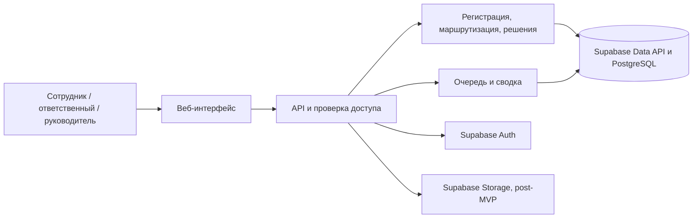

# 02 — Архитектура Kinetria AI

## Компоненты и поток данных

Next.js обслуживает интерфейс и API приложения. Supabase Auth выдаёт сессию, а сервер Next.js проверяет личность и обращается к Supabase Data API с JWT пользователя. PostgreSQL хранит обращения, связи, историю, настройки и уведомления. RLS действует и при прямых запросах к Data API. Для тестовых вложений post-MVP используется приватный Supabase Storage.

Для записи используем транзакционные SQL-функции через RPC Data API. Создание в одной транзакции записывает карточку, назначение или резервную очередь, событие истории и, когда уведомления добавлены, запись для получателя. Смена ответственного, запрос уточнения и публикация решения обновляют карточку, события и уведомления в той же транзакции. Аналитика считает показатели по событиям с применением области доступа.

## Реализованный MVP и маршруты

`app/page.tsx` — публичный лендинг, `app/login/page.tsx` — вход, `app/workspace/[role]/page.tsx` — кабинет. Сервер проверяет сессию и активный профиль перед выдачей страницы, а при несовпадении роли возвращает 404. Тестовые аккаунты создаются отдельным скриптом. Локальный режим разработки использует подписанную сессию и синтетические данные без Supabase.

Сотрудник создаёт обращение и видит свои карточки на `/workspace/employee`. Руководитель открывает доску на `/workspace/manager`, ответственный видит назначения на `/workspace/handler`. Карточка открывается в том же кабинете по параметру `id`. Действия формы идут через Server Actions. Для создания и рассмотрения они вызывают `submit_request` и `review_request` в Data API с сессией пользователя.

### Язык и тема

`next-intl` загружает один из словарей `messages/ru.json`, `messages/en.json`, `messages/kk.json`. Сервер читает `kinetria_locale` и `kinetria_theme` и задаёт `lang` и `data-theme` на корневом элементе. Переключатели сохраняют выбор в cookie для всего сайта. По умолчанию используются русский язык и тёмная тема. Маршруты сохраняют прежние адреса.

### Хранение и доступ в MVP

В Supabase хранятся `profiles`, `request_categories`, `requests`, `request_events` и приватная таблица маршрутов. RLS показывает сотруднику его карточки и историю, ответственному — текущие назначения, руководителю — категории его направления, администратору — общий реестр. Клиент не получает доступа к внутренним обращениям. Таблицы карточек и событий доступны приложению для чтения. Операции записи проверяют роль, область доступа, версию и переход в БД. Карточка и событие сохраняются одной транзакцией. Начальные маршруты загружаются из SQL, затем их может менять администратор. При отсутствии активного получателя карточка попадает в резерв.

Далее описана целевая модель для развития, включая раздельные очереди, сроки, API для интеграций, вложения и уведомления.

## Чат и создание карточки

Сотрудник вводит описание и по желанию запускает AI-черновик. Сервер передаёт описание и активные категории выбранному провайдеру и проверяет структурированный ответ. Локальная Ollama принимает запросы от Next.js на `127.0.0.1:11434`. Для локального запуска также доступны OpenAI и Gemini с ключом владельца установки. На Vercel генерация отключена. Автор редактирует полученные поля в той же форме. При сбое модели введённые поля остаются на месте.

До подтверждения черновик остаётся в состоянии формы. При отправке сервер проверяет поля, а транзакция PostgreSQL записывает обращение, маршрут и историю. Для демо используем синтетические примеры. Сводка использует тему, описание, предложение, статус, решение и следующий шаг. История обсуждения в запрос не передаётся. Условия передачи реальных данных внешнему провайдеру согласуются до пилота.

В post-MVP поиск похожих записей выполняется в рамках доступных очередей. Система предлагает связь руководителю, а подтверждение записывает её отдельно от исходных карточек. Сводка считает уникальных авторов в доступной части группы. Оценка затрат, прогноз и фактический эффект хранятся как отдельные поля инициативы с единицей измерения, периодом и источником замера.

## Данные

Supabase Auth хранит учётные записи. Прикладной профиль связан с Auth по ID пользователя. В PostgreSQL лежат карточки, область доступа, история и связи, а в приватном Storage — байты вложений. Список для формы отдаёт только активные категории и их публичные для сотрудников поля. Настройки владельцев и резервных очередей выдаются через отдельный административный маршрут.

| Сущность | Поля и ограничения |
|---|---|
| Supabase Auth, UserProfile, RoleScope | Учётная запись в Auth, профиль по ID пользователя, подразделение, активность, роль и область рассмотрения |
| Category, RoutingRule | Активность, категория, очередь, владелец по умолчанию, целевые интервалы. У категории одно активное правило. Общая резервная очередь покрывает отсутствие правила |
| Request | UUID и уникальный видимый номер, автор и подразделение на момент подачи, тип, категория, текст, предлагаемое решение, очередь, владелец, приоритет, статус, итог, следующий шаг, сроки, версия |
| RequestEvent | Обращение, время, актор, вид события, изменения, видимость, текст сообщения. История дописывается |
| RequestRelation | Связь обращения с первичным в той же области. У повтора один первичный, циклы и цепочки запрещены. У автора сохраняется доступ к своей записи |
| Attachment | Обращение, автор загрузки, ключ, безопасное имя, тип, размер. Выдача через API по правам на карточку |
| Notification | Получатель, событие, дата прочтения. Уникальная пара получатель–событие |

## Целевой HTTP API для развития

| Действие | Интерфейс |
|---|---|
| Подготовить вопрос или черновик | POST /api/request-drafts. Вход для активного пользователя, без создания обращения |
| Создать и открыть | POST /api/requests после подтверждения автором, GET /api/requests/:id |
| Очередь и карточки автора | GET /api/requests с областью, фильтрами и пагинацией |
| Назначить, запросить уточнение, ответить, завершить | POST /api/requests/:id/actions с типом действия и ожидаемой версией |
| Получить файл | GET /api/requests/:id/attachments/:attachmentId |
| Просмотреть сводку, уведомления | GET /api/metrics, GET /api/notifications |
| Отметить прочтение | POST /api/notifications/:id/read |
| Активные категории для формы | GET /api/categories |
| Просмотреть и изменить маршруты (post-MVP) | GET /api/routing-rules, PATCH /api/routing-rules/:id |

При создании клиент передаёт ключ идемпотентности, уникальный в пределах автора. Повтор с тем же телом возвращает существующий номер. Повтор с другим телом или устаревшая версия при изменении дают 409. Невалидные данные и переходы получают 422. Записи вне доступа возвращают 404. Смена версии и проверка перехода выполняются атомарно. При сбое записи файла временный объект удаляется, оставшиеся после прерывания процесса файлы без ссылки подлежат периодической очистке.

## Доступ и безопасность

### Матрица прав RBAC

«Сотрудник» — базовая роль внутреннего пользователя. Рабочие роли определяют дополнительные разрешения и область на следующем этапе. Клиент компании имеет отдельную роль и внешний кабинет без доступа к внутренним обращениям, очередям и настройкам. В таблице «—» означает, что роль сама по себе не даёт права. Роли и область берём из БД.

| Действие | Сотрудник | Ответственный | Руководитель | Администратор | Клиент |
|---|---|---|---|---|---|
| Подготовить черновик, подать обращение и читать видимую историю, статус и итог | Свои | Как сотрудник | Как сотрудник | Как сотрудник | — |
| Ответить на уточнение (post-MVP) | Свои, в статусе «Ожидает уточнения» | Как сотрудник | Как сотрудник | Как сотрудник | — |
| Читать рабочую карточку и служебные события | — | Текущие назначения | Свои очереди, включая резерв при наличии полномочий | — | — |
| Менять статус, запрашивать уточнение (post-MVP), публиковать итог | — | Текущие назначения | Свои очереди | — | — |
| Назначать или менять владельца | — | — | Свои очереди, владелец с доступом к очереди | — | — |
| Добавить или скачать файл (post-MVP) | Свои карточки, добавление только в открытые | Текущие назначения | Свои очереди | — | — |
| Смотреть сводку и связывать повторы (post-MVP) | — | — | Свои очереди | — | — |
| Настраивать категории и маршруты (post-MVP) | — | — | — | Да | — |

После регистрации исходный текст дополняется через события. После переназначения прежний владелец теряет доступ, полученный через назначение. RLS на карточках и событиях проверяет авторство, актуальное назначение и область очереди. Служебные поля хранятся отдельно от данных, доступных автору, либо выдаются через интерфейс БД с ограниченным набором полей. Прямой Data API обязан соблюдать те же ограничения, что и экран. [Документация Supabase по RLS](https://supabase.com/docs/guides/database/postgres/row-level-security)

Автор видит обращённые к нему сообщения, опубликованный итог, текущий статус и назначение. Служебные события и ссылки на чужие обращения доступны только уполномоченным ролям. Сервер фильтрует поля, события, поиск и агрегаты. Проверяем прямые ссылки, скачивание и действия чужой роли.

Сессии ведёт Supabase Auth через SSR-клиент и cookies. Сервер проверяет JWT, а права берёт из активного профиля и назначений в БД. Для изменений проверяется источник запроса. Прямая запись в таблицы домена закрыта для прикладных ролей. Для RPC с повышенными правами ограничиваем EXECUTE, фиксируем search_path и проверяем auth.uid(), роль, область и переход внутри функции. Вложения защищены политиками Storage. Файлы ограничены по размеру и разрешённым типам, выдаются на скачивание. Тексты и вложения исключены из технических логов. Для пилота согласуются хранение, резервное копирование и восстановление, сканирование файлов и правила работы с чувствительными обращениями.

## Корпоративные интеграции

| Система | Цель и обмен | Что проверить перед пилотом |
|---|---|---|
| Битрикс24 | Справочник сотрудников и подразделений → Kinetria AI через REST при наличии доступа. Kinetria AI → Битрикс24 отправляет событие с номером и ссылкой после согласования канала | Облачный или коробочный вариант, права API, устойчивые ID, обработка увольнений, видимость ссылок, лимиты |
| 1С УТ | В перспективе ссылка на карточку номенклатуры для вопросов типа A-003. Чтение разрешённого идентификатора и наименования через согласованный API или выгрузку | Версия и расширения 1С, ответственный за справочник, права, допустимый состав данных и способ синхронизации |

В MVP назначение берётся из локального справочника. Уведомления post-MVP сохраняются в приложении. После пилота внешнюю доставку можно добавить через outbox с повторами, а корпоративную идентификацию — через согласованный провайдер.
