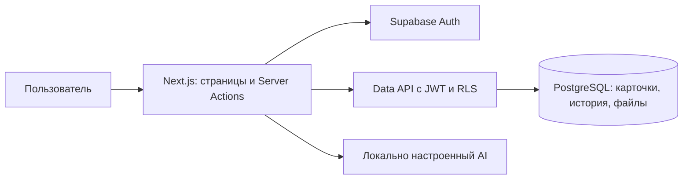

# 02 — Архитектура IdeaRoute

## Компоненты и поток данных

Next.js App Router обслуживает страницы, Server Actions и скачивание файлов. Supabase Auth выдаёт сессию; сервер проверяет JWT и активный профиль. Все обычные запросы в PostgreSQL Data API выполняются с JWT пользователя и RLS. Ключ с повышенными правами не используется для чтения рабочих экранов.

Создание, назначение, рассмотрение, ответ и публикация решения используют RPC с проверкой роли, области, версии и перехода. Карточка и событие записываются атомарно. Вложения текущего MVP — base64 в PostgreSQL, а не Supabase Storage; ограничения 3 × 1 МиБ. Большие файлы в приватном объектном хранилище — развитие.

## Реализованный MVP и маршруты

Лендинг — `app/page.tsx`, вход — `app/login/page.tsx`, кабинеты — `app/workspace/[role]/page.tsx`. Профиль и роль проверяются до выдачи страницы. Чужой кабинет возвращает 404. В разработке без Supabase доступен подписанный локальный предпросмотр на общем синтетическом наборе, который не доказывает реальные права.

Разделы выбираются `?view=overview|new|registry|results|analytics|insights|notifications|categories|routing|help`, карточка — `?id=<uuid>`. `analytics` и `insights` закрыты на сервере для сотрудника и клиента. Настройки доступны только администратору; создание — сотруднику.

### Язык и тема

`next-intl` использует `messages/ru.json`, `en.json`, `kk.json`. Сервер читает `kinetria_locale` и `kinetria_theme`, задаёт `lang` и `data-theme`. Выбор сохраняется cookie через Server Actions. По умолчанию русский язык и тёмная тема. Лендинг, вход и кабинет используют общий Preferences с выбором языка и темы. Серверные экраны получают переводы через getTranslations, синхронные/клиентские компоненты — useTranslations; NextIntlClientProvider получает тот же request config. Cookie HttpOnly, SameSite=Lax, path=/, срок один год; неподдерживаемый язык даёт ru. localStorage не используется: он недоступен серверной отрисовке. Сохранение предпочтений в профиле БД для нескольких устройств остаётся последующим расширением. `adaptive.css` задаёт семантические цвета и мобильные правила поверх базовой композиции.

### Данные и обновление

`RequestWorkspace` получает карточки через Data API с RLS, затем передаёт доступные строки обзору, реестру и аналитике. `WorkspaceLive` обновляет страницу каждые 30 секунд, когда пользователь не заполняет форму. Счётчики меню также читают доступные карточки. Текущий подход загружает набор в память и ограничен размером ответа Data API; для рабочего масштаба нужны серверные агрегаты и пагинация.

`lib/insights.ts` — общий расчёт тем, уникальных карточек и сортировки. Только проблемы с общей категорией и тегом образуют группу. Данные чужих областей не загружаются для вычисления счётчиков. Группа не создаёт связь в БД; решения, сроки и статусы принадлежат исходным карточкам. Кольцевая диаграмма и KPI дедуплицируют ID, бары тем могут пересекаться.

## Чат и создание карточки

Ручная форма работает без AI. При настроенном локальном провайдере Next.js отправляет описание и справочник категорий в Ollama (`127.0.0.1:11434`), OpenAI или Gemini; структурированный ответ проверяется сервером. Введённое описание и выбранная пользователем категория сохраняются. До подтверждения в БД записи нет. На Vercel AI выключен через `aiConfig`.

AI-сводка доступной карточки использует тему, описание, предложение, статус, решение и следующий шаг, без полной истории обсуждения. Сбой модели не отменяет ручную подачу. Передачу реальных текстов внешнему провайдеру согласуют до пилота.

## Данные

| Сущность | Реализация |
|---|---|
| Auth и `profiles` | Аккаунт, активность, роль, отображаемое имя |
| `request_categories` | Локализованное название, активность, подразделение, `sla_days` |
| Приватные маршруты и области | Категория, владелец, активность маршрута; категории руководителя |
| `requests` | UUID, номер, автор, категория, тип, тема, описание, предложение, тональность, теги, назначение, статус, решение, шаг, приоритет, дата срока, версия и временные отметки |
| `request_events` | Дописываемая история создания, назначения, рассмотрения, ответа, комментария, параметров и ознакомления |
| `request_receipts` | Последняя прочитанная версия карточки для пользователя, защищена отдельными RLS-политиками |
| `request_attachments` | Имя, размер и base64-содержимое, доступ через права на карточку |

Отдельные `RequestRelation`, очередь внешних уведомлений, оценка затрат/эффекта и объектное хранилище пока не реализованы.

## Доступ и безопасность

### Матрица прав RBAC

| Действие | Сотрудник | Ответственный | Руководитель | Администратор | Клиент |
|---|---|---|---|---|---|
| Создать | Свои | — | — | — | — |
| Читать карточку, историю, файлы | Свои | Текущие назначения | Категории направления | Все внутренние | — |
| Ответить на уточнение | Свои | — | — | — | — |
| Рассмотреть и опубликовать итог | — | Назначенные | Свои категории | — | — |
| Назначить владельца | — | — | Свои категории | Из резерва | — |
| Менять срок/приоритет | — | Назначенные открытые | Свои открытые | Открытые | — |
| Комментировать | Свои | Назначенные | Свои категории | Доступные | — |
| Читать результаты и уведомления | Свои | Назначенные | Свои категории | Общие | — |
| Аналитика и повторяющиеся темы | — | Назначенные | Свои категории | Общие | — |
| Категории и маршруты | — | — | — | Да | — |

RLS ограничивает прямой Data API, а RPC дополнительно проверяют роль, активность, область, версию и переход. Прежний назначенный теряет доступ при переназначении, если не имеет другого основания. Секретный ключ остаётся в серверном скрипте подготовки аккаунтов. Имена участников выдаются только в контексте доступного обращения.

`GET /api/attachments/[id]` проверяет сессию и доступ к файлу, возвращает его как скачивание. Файлы хранятся с лимитами и безопасными именами; промышленное сканирование и политика хранения требуют согласования. Cookie сессии обслуживается SSR-клиентом и `proxy.ts`.

Уведомления текущего MVP — представление последних состояний и прочитанных версий; внешняя доставка и отдельный журнал доставки каждого события отсутствуют.

## Корпоративные интеграции

| Система | Возможный обмен | Что согласовать |
|---|---|---|
| Битрикс24 | Справочник сотрудников и уведомление с номером/ссылкой | Версия, API, права, стабильные ID, увольнения, допустимый канал |
| 1С УТ | Ссылка на номенклатуру по мотивам A-003 | Версия, ответственный, идентификаторы, чтение и синхронизация |
| Корпоративный чат / Telegram | Подача и статусы | Идентификация автора, область данных, согласование канала |

Интеграции не подключены. HTTP API для внешних клиентов, SSO, outbox с повторами и подтверждённые связи дубликатов относятся к развитию. Текущие действия — Server Actions и RPC, а не отдельный REST CRUD приложения.

## Переходы авторизации

Формы входа/выхода отправляют обычный POST в `/auth/login` и `/auth/logout`. Обработчики проверяют Origin, изменяют cookie и возвращают 303 непосредственно на экран роли или входа. Формы работают без JavaScript; клиент добавляет состояние ожидания и защиту от повторной отправки. Авторизация пользователя и активная роль читаются с сервера; `getProfile` дедуплицируется только в пределах одного React-render, без общего кеша между пользователями.

Выход использует `scope: local`. Сетевые запросы входа ограничены 8 с, выхода — 5 с на запрос. Cookie текущего проекта, включая чанки, очищаются и при ошибке удалённого отзыва. Это гарантирует выход из данного браузера; отзыв refresh token при недоступном Auth не гарантируется, ранее выданный access token живёт до своего срока. Другие сессии не завершаются.

Во время отправки формы авторизации автообновление кабинета приостанавливается. Полные списки карточек не загружаются для деталей, создания и справки; маршрутизация запрашивается только там, где нужна. Доменные права и RLS не менялись.
