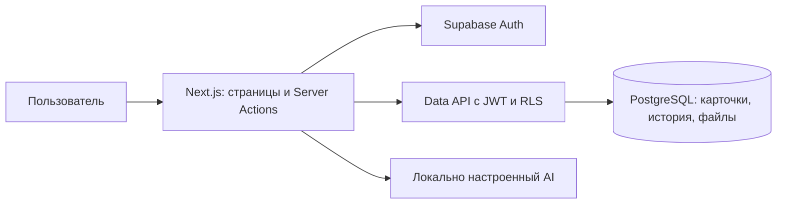

# 02 — Архитектура IdeaRoute

Актуальный срез 13.11.2026: **IdeaRoute**. Qvin, сохраняемые AI-темы и клиентский портал Web/Telegram реализованы; CSAT/NPS, SSO, RAG и 1С/Б24 — план. [Единый статус и ограничения](TENDER_AUDIT.md) · [Шесть сценариев](../README.md#scenarios) · [Свежие записи](DEMO_RECORDING.md). Исторические результаты ниже относятся к указанным в них прогонам.

## Компоненты и поток данных

Next.js App Router обслуживает страницы, Server Actions и скачивание файлов. Supabase Auth выдаёт сессию; сервер проверяет JWT и активный профиль. Все обычные запросы в PostgreSQL Data API выполняются с JWT пользователя и RLS. Ключ с повышенными правами не используется для чтения рабочих экранов.

Создание, назначение, рассмотрение, ответ и публикация решения используют RPC с проверкой роли, области, версии и перехода. Карточка и событие записываются атомарно. Вложения текущего MVP — base64 в PostgreSQL, а не Supabase Storage; ограничения 3 × 1 МиБ. Большие файлы в приватном объектном хранилище — развитие.

## Реализованный MVP и маршруты

Лендинг — `app/page.tsx`, вход — `app/login/page.tsx`, кабинеты — `app/workspace/[role]/page.tsx`. Профиль и роль проверяются до выдачи страницы. Чужой кабинет возвращает 404. В разработке без Supabase доступен подписанный локальный предпросмотр на общем синтетическом наборе, который не доказывает реальные права.

Разделы выбираются `?view=overview|new|registry|results|analytics|insights|notifications|categories|routing|help`, карточка — `?id=<uuid>`. `analytics` и `insights` закрыты на сервере для сотрудника и клиента. Настройки доступны только администратору; создание — сотруднику.

### Язык и тема

`next-intl` использует `messages/ru.json`, `en.json`, `kk.json`. Сервер читает `kinetria_locale` и `kinetria_theme`, задаёт `lang` и `data-theme`. Язык сохраняется через Server Action, тема — через POST `/api/preferences/theme` с проверкой Origin; тема меняет корневой CSS сразу, при ошибке сохранения возвращается прежняя. POST сохраняет HttpOnly-cookie без обновления RSC. По умолчанию русский язык и тёмная тема. Лендинг, вход и кабинет используют общий Preferences с выбором языка и темы. Серверные экраны получают переводы через getTranslations, синхронные/клиентские компоненты — useTranslations; NextIntlClientProvider получает только клиентские пространства активной локали; newLanding передаётся отдельной границей внутри main лендинга. Cookie HttpOnly, SameSite=Lax, path=/, срок один год; неподдерживаемый язык даёт ru. localStorage не используется: он недоступен серверной отрисовке. Сохранение предпочтений в профиле БД для нескольких устройств остаётся последующим расширением. `adaptive.css` задаёт семантические цвета и мобильные правила поверх базовой композиции.

### Данные и обновление

`RequestWorkspace` получает карточки через Data API с RLS, затем передаёт доступные строки обзору, реестру и аналитике. `WorkspaceLive` обновляет страницу каждые 30 секунд, когда пользователь не заполняет форму. Счётчики меню также читают доступные карточки. Текущий подход загружает набор в память и ограничен размером ответа Data API; для рабочего масштаба нужны серверные агрегаты и пагинация.

`lib/insights.ts` — общий расчёт тем, уникальных карточек и сортировки. В теговой аналитике проблемы с общей категорией и тегом образуют группу. Смысловые AI-темы и их сохранение реализованы отдельным сервисом. Данные чужих областей не загружаются для вычисления счётчиков. Теговая группа не создаёт связь в БД; сохраняемая AI-тема записывает ID в topic_requests; решения, сроки и статусы принадлежат исходным карточкам. Кольцевая диаграмма и KPI дедуплицируют ID, бары тем могут пересекаться.

## Чат и создание карточки

Ручная форма работает без AI. При настроенном локальном провайдере Next.js отправляет описание и справочник категорий в Ollama (`127.0.0.1:11434`), OpenAI или Gemini; структурированный ответ проверяется сервером. Введённое описание и выбранная пользователем категория сохраняются. До подтверждения в БД записи нет. На Vercel `aiConfig` допускает только явно выбранный Groq; Ollama/OpenAI/Gemini в этом окружении остаются отключены.

AI-сводка доступной карточки использует тему, описание, предложение, статус, решение и следующий шаг, без полной истории обсуждения. Сбой модели не отменяет ручную подачу. Передачу реальных текстов внешнему провайдеру согласуют до пилота.

## Данные

| Сущность | Реализация |
|---|---|
| Auth и `profiles` | Аккаунт, активность, роль, отображаемое имя |
| `request_categories` | Локализованное название, активность, подразделение, `sla_days` |
| Приватные маршруты и области | Категория, владелец, активность маршрута; категории руководителя |
| `requests` | UUID, номер, автор, категория, тип, тема, описание, предложение, тональность, теги, назначение, статус, решение, шаг, приоритет, дата срока, версия и временные отметки |
| `request_events` | Дописываемая история создания, назначения, рассмотрения, ответа, комментария, параметров и ознакомления |
| `request_receipts` | Последняя прочитанная версия карточки для пользователя, защищена отдельными RLS-политиками |
| `request_attachments` | Имя, размер и base64-содержимое, доступ через права на карточку |

Очередь внешней Telegram-доставки реализована в P1. Связи исходных карточек с сохраняемыми темами реализованы в `topics`/`topic_requests`; потенциальный эффект — в `request_enrichments`. Подтверждённые отношения дубликатов, реальные финансовые ставки и объектное хранилище не реализованы.

## Доступ и безопасность

### Матрица прав RBAC

| Действие | Сотрудник | Ответственный | Руководитель | Администратор | Клиент |
|---|---|---|---|---|---|
| Создать | Свои | — | — | — | — |
| Читать карточку, историю, файлы | Свои | Текущие назначения | Категории направления | Все внутренние | — |
| Ответить на уточнение | Свои | — | — | — | — |
| Рассмотреть и опубликовать итог | — | Назначенные | Свои категории | — | — |
| Назначить владельца | — | — | Свои категории | Из резерва | — |
| Менять срок/приоритет | — | Назначенные открытые | Свои открытые | Открытые | — |
| Комментировать | Свои | Назначенные | Свои категории | Доступные | — |
| Читать результаты и уведомления | Свои | Назначенные | Свои категории | Общие | — |
| Аналитика и повторяющиеся темы | — | Назначенные | Свои категории | Общие | — |
| Категории и маршруты | — | — | — | Да | — |

RLS ограничивает прямой Data API, а RPC дополнительно проверяют роль, активность, область, версию и переход. Прежний назначенный теряет доступ при переназначении, если не имеет другого основания. Секретный ключ остаётся в серверном скрипте подготовки аккаунтов. Имена участников выдаются только в контексте доступного обращения.

`GET /api/attachments/[id]` проверяет сессию и доступ к файлу, возвращает его как скачивание. Файлы хранятся с лимитами и безопасными именами; промышленное сканирование и политика хранения требуют согласования. Cookie сессии обслуживается SSR-клиентом и `proxy.ts`.

Веб-уведомления — представление последних состояний и прочитанных версий. Telegram использует отдельный outbox и журнал прогресса доставки; детали и границы проверки ниже.

## Корпоративные интеграции

| Система | Возможный обмен | Что согласовать |
|---|---|---|
| Битрикс24 | Справочник сотрудников и уведомление с номером/ссылкой | Версия, API, права, стабильные ID, увольнения, допустимый канал |
| 1С УТ | Ссылка на номенклатуру по мотивам A-003 | Версия, ответственный, идентификаторы, чтение и синхронизация |
| Корпоративный чат / Telegram | Подача и статусы | Идентификация автора, область данных, согласование канала |

Корпоративные интеграции не подключены. Telegram transport и outbox с повторами добавлены в P1; живой webhook требует настройки. HTTP API для внешних клиентов, SSO и подтверждённые связи дубликатов относятся к развитию. Текущие действия — Server Actions и RPC, а не отдельный REST CRUD приложения.

## Переходы авторизации

Формы входа/выхода отправляют обычный POST в `/auth/login` и `/auth/logout`. Обработчики проверяют Origin, изменяют cookie и возвращают 303 непосредственно на экран роли или входа. Формы работают без JavaScript; клиент добавляет состояние ожидания и защиту от повторной отправки. Авторизация пользователя и активная роль читаются с сервера; `getProfile` дедуплицируется только в пределах одного React-render, без общего кеша между пользователями.

Выход использует `scope: local`. Сетевые запросы входа ограничены 8 с, выхода — 5 с на запрос. Cookie текущего проекта, включая чанки, очищаются и при ошибке удалённого отзыва. Это гарантирует выход из данного браузера; отзыв refresh token при недоступном Auth не гарантируется, ранее выданный access token живёт до своего срока. Другие сессии не завершаются.

Во время отправки формы авторизации автообновление кабинета приостанавливается. Полные списки карточек не загружаются для деталей, создания и справки; маршрутизация запрашивается только там, где нужна. Доменные права и RLS не менялись.

## Telegram transport P1

`POST /api/telegram/webhook` проверяет `X-Telegram-Bot-Api-Secret-Token`, принимает только private chat и хранит update_id/lease в БД. `lib/telegram/api.ts` ограничивает размер файлов и ожидание внешних HTTP; голос отправляется на Groq Whisper, текстовый AI — через Groq при `AI_PROVIDER=groq`. Vercel не запускает Whisper локально.

`telegram_link_token()` выдаёт токен текущего авторизованного пользователя на 10 минут. Bridge принимает Telegram ID только от серверного service_role, разрешает его через `telegram_links` и проверяет активный профиль. `SECURITY DEFINER` bridge имеет фиксированный пустой search_path, закрыт для anon/authenticated и явно повторяет область чтения (автор/назначение/категория/admin). Для записи устанавливает идентичность привязанного пользователя в рамках транзакции и вызывает существующие приватные доменные функции. Обход доменных проверок/версий через произвольный p_data не разрешается.

Добавлены RLS-таблицы без клиентских grants: `telegram_links`, `telegram_tokens`, `telegram_sessions`, `telegram_updates`, `telegram_outbox`, `telegram_channel_messages`. Триггер `requests` атомарно добавляет outbox для обоих каналов ввода; очередь содержит снимок события назначения. `lib/telegram/delivery.ts` обновляет исходную карточку канала, публикует назначение, уведомляет автора/текущего назначенного и сохраняет прогресс. Серверный секрет нужен этому узкому транспорту, веб-RLS не заменяется сервисным чтением.

После действия `after()` запускает доставку; повторы — `POST /api/telegram/deliver` с `CRON_SECRET` и внешним планировщиком. Exactly-once отправки Telegram не гарантируется; возможны дубли при разрыве между API и подтверждением в БД. Настройка и границы данных: [TELEGRAM](TELEGRAM.md), статус проверки: [VALIDATION](VALIDATION.md).

Демо-расширение: `telegram_demo_sessions` хранит отдельный диалог по Telegram/user ID; `telegram_demo_login` закрыта для anon/authenticated и принимает только существующий активный внутренний синтетический аккаунт. JS-транспорт дополнительно требует `TELEGRAM_DEMO_ENABLED=true` и allowlist Telegram ID; настоящий user ID получает через Supabase Auth вход в тот же демоаккаунт, что на сайте. Чужая занятая привязка не перехватывается. Транспорт — HTTPS webhook Next.js на Vercel. Сессии и lease уже хранятся в Supabase; доступность бота и БД проверяется защищённым GET probe до регистрации webhook.

## Уточнение запуска и навигации после f9b384f

Telegram bridge выбирает list/reserve по created_at DESC, number DESC LIMIT 10; stats — LIMIT 30. Бот переворачивает список для показа новых внизу. APP_URL формирует URL /login; перенос cookie или автологин отсутствует. Миграция 20261112114318_telegram_recent_requests.sql сохраняет scope и grants.

## Telegram: инструкции ролей и webhook

После выбора аккаунта доступны инструкция текущей роли и кнопка дашборда → APP_URL/login; /help не меняет черновик. Сотрудник работает со своими обращениями, ответственный — с назначениями, руководитель — с направлением, администратор — с общим реестром и резервом; настройки остаются в вебе. Основной транспорт — HTTPS webhook Next.js на Vercel, polling отключён. Состояние, архивы демо и update_id уже хранятся в Supabase. Регистрация: pnpm telegram:webhook, проверка: pnpm telegram:check. [Запуск и ограничения](TELEGRAM.md).

В размещённом синтетическом контуре ранее проверены webhook, вход и реестр четырёх ролей; применены 11 миграций и подготовлены 9 демопрофилей и 20 обращений. Адреса и идентификаторы инфраструктуры задаются через окружение и не публикуются. Эта проверка не подтверждает redeploy последующих исправлений. [Результаты](VALIDATION.md#подключение-интеграционной-базы-и-живой-webhook).

## Ревью Telegram после 397c041

Локально проверен webhook → общий доменный Closed-Loop: создание/вложение → назначение и срок → уточнение/ответ → работа → решение/ознакомление, а также резерв администратора. Исправлены повторы после сбоев RPC и отправки, независимая доставка уведомлений, старые кнопки назначения и чтение полного вопроса/истории. Схема и права сохранены. Исправления ещё требуют redeploy; реальный Whisper и расписание outbox отдельно не подтверждены. [Находки, проверки и ограничения](CODE-REVIEW.md#ревью-миграции-telegram-polling--webhook).

## Конфигурация без инфраструктурных данных в Git

Реальные URL, project ref, deployment ID, Telegram ID и ключи задаются через окружение. В примерах используются placeholders. Проверка tracked-файлов и всех локальных объектов Git: `python3 scripts/check-repository-security.py`, затем `--history`. Значения совпадений не выводятся. [Правила и границы проверки](../README.md#security).

## Telegram UX после ревью webhook

Инлайн-навигация использует editMessageText; цель сообщения изолирована на update через AsyncLocalStorage. Сбои сети остаются retryable, удалённое сообщение допускает новую отправку. Полный [UX-гайд и дерево роутов](TELEGRAM-UX.md); [проверки](VALIDATION.md#telegram-ux-после-ревью-webhook).

## Асинхронный Telegram и трассируемость

Webhook сохраняет update в PostgreSQL до HTTP 200; `after()` и планировщик обрабатывают очередь с изоляцией пользователя, повтором и общим лимитером Telegram API. 13.11.2026 миграция `20261112181447_telegram_async_inbox.sql` применена к production через существующее подключение Vercel PostgreSQL; deployment READY, webhook перерегистрирован, накопившиеся обновления обработаны. [Проверка восстановления](VALIDATION.md#восстановление-production-telegram-13112026). 50–100 RPS в целевой среде ещё не измерены. [Сценарии четырёх ролей, матрица Vision/ТЗ и границы проверки](10-e2e-flows-and-traceability.md).

Telegram: инструкция перед записью разбита на блоки с типами, категориями и примером; редакторы и вложения имеют возврат к предпросмотру, подтверждение выделено отдельно. Единая публичная команда выбора аккаунта — `/login`. Актуальные [переходы, хранение файлов и обновление меню](TELEGRAM-UX.md#итерация-инструкция-вложения-и-меню); deployment и `pnpm telegram:webhook` выполнены 13.11.2026, [результаты](VALIDATION.md#восстановление-production-telegram-13112026).

## Вход по намерению и смена демоаккаунта (13.11.2026)

POST `/auth/login` принимает `account` (либо `role` в локальном preview) и `intent`. Раздел назначения выбирается из whitelist для **серверного активного профиля**, а не из заявленной клиентом роли. Неизвестное намерение/URL заменяется стартовым разделом роли; RLS и доменные права не меняются. В demo-gate `/login` остаётся доступным при активной сессии, а «Сменить роль» из кабинета возвращает к полному списку аккаунтов. Выбор нового аккаунта выполняет обычный вход; Telegram-привязки не меняются. Без demo-gate вход существующей сессии перенаправляется в кабинет. [Намерения, переходы и приёмка](09-dashboard-spec.md#вход-жизненный-цикл-и-демоаккаунты-13112026).

## Обновление App Shell и Hero (13.11.2026)

App Shell использует дополнительный `app/workspace/floating-shell.css` после существующих стилей. `mode` передаётся из query в шапку. Существующий ключ реестра по query повторно инициализирует контролы при переходе между списком и Lifecycle; стартовый `mode=board` теперь также учитывается для сотрудника, у которого доска уже доступна через переключатель. Серверная авторизация сохранена. Поиск шапки — GET `view=registry&q=…`. Схема БД, RPC и RLS не изменены.

Telegram Qvin (13.11.2026): исправлена совместимость со старым маршрутом БД с сохранением области доступа, добавлены возврат и повтор вопроса; живая AI-проверка выполнена на 63 доступных обращениях. [Причина, реализация и проверки](WORKSPACE-UPDATE.md#qvin-в-telegram-совместимость-и-возврат-13112026).
## Клиентский портал, Qvin и сохраняемые темы

`feedback` хранит приватный исходный отзыв и связь с внутренним request; публикация/ответ — отдельные поля с модерацией, `feedback_votes` фиксирует поддержку. Клиент видит своё и разрешённую публичную проекцию, без внутренней карточки. `feedback_service` и Telegram bridge используют общие проверки.

`topics`/`topic_requests` сохраняют AI-темы и ID исходных обращений через `topic_service`; web и Telegram читают один источник. API генерации принимает 2–200 ID и перечитывает их с RLS. `request_enrichments` хранит оценку потенциального эффекта, не подтверждённую экономию. Qvin отвечает по разрешённому отфильтрованному снимку; legacy-схема без origin поддерживается. Корпоративные контракты: [Brief](TENDER_BRIEF.md#3-техническая-концепция-и-доступ).

Права AI: Qvin по реестру — только admin/manager; генерация тем и повторная оценка эффекта — admin/manager/handler, с повторным чтением разрешённых ID. Клиент и сотрудник не получают аналитический доступ.
