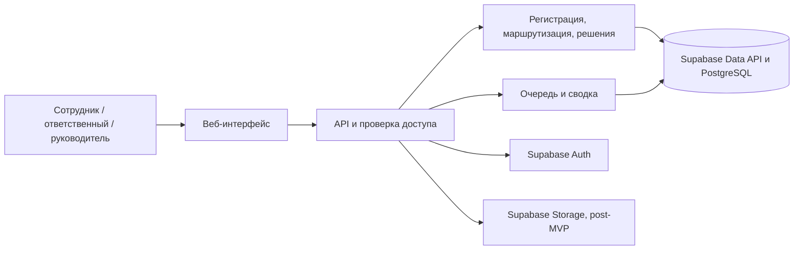

# 02 — Архитектура Modus IDEA

## Компоненты и поток данных

Next.js обслуживает интерфейс и API приложения. Supabase Auth выдаёт сессию, а сервер Next.js проверяет личность и обращается к Supabase Data API с JWT пользователя. PostgreSQL хранит обращения, связи, историю, настройки и уведомления. RLS действует и при прямых запросах к Data API. Для тестовых вложений post-MVP используется приватный Supabase Storage.

Для записи используем транзакционные SQL-функции через RPC Data API. Создание в одной транзакции записывает карточку, назначение или резервную очередь, событие истории и, когда уведомления добавлены, запись для получателя. Смена ответственного, запрос уточнения и публикация решения обновляют карточку, события и уведомления в той же транзакции. Аналитика считает показатели по событиям с применением области доступа.

## Данные

| Сущность | Поля и ограничения |
|---|---|
| Supabase Auth, UserProfile, RoleScope | Учётная запись в Auth, профиль по ID пользователя, подразделение, активность, роль и область рассмотрения |
| Category, RoutingRule | Активность, категория, очередь, владелец по умолчанию, целевые интервалы. У категории одно активное правило. Общая резервная очередь покрывает отсутствие правила |
| Request | UUID и уникальный видимый номер, автор и подразделение на момент подачи, тип, категория, текст, предлагаемое решение, очередь, владелец, приоритет, статус, итог, следующий шаг, сроки, версия |
| RequestEvent | Обращение, время, актор, вид события, изменения, видимость, текст сообщения. История дописывается |
| RequestRelation | Связь обращения с первичным в той же области. У повтора один первичный, циклы и цепочки запрещены. У автора сохраняется доступ к своей записи |
| Attachment | Обращение, автор загрузки, ключ, безопасное имя, тип, размер. Выдача через API по правам на карточку |
| Notification | Получатель, событие, дата прочтения. Уникальная пара получатель–событие |

## Контракт сервера

| Действие | Интерфейс |
|---|---|
| Создать и открыть | POST /api/requests, GET /api/requests/:id |
| Очередь и карточки автора | GET /api/requests с областью, фильтрами и пагинацией |
| Назначить, запросить уточнение, ответить, завершить | POST /api/requests/:id/actions с типом действия и ожидаемой версией |
| Получить файл | GET /api/requests/:id/attachments/:attachmentId |
| Просмотреть сводку, уведомления | GET /api/metrics, GET /api/notifications |
| Отметить прочтение | POST /api/notifications/:id/read |

При создании клиент передаёт ключ идемпотентности, уникальный в пределах автора. Повтор с тем же телом возвращает существующий номер. Повтор с другим телом или устаревшая версия при изменении дают 409. Невалидные данные и переходы получают 422. Записи вне доступа возвращают 404. Смена версии и проверка перехода выполняются атомарно. При сбое записи файла временный объект удаляется, оставшиеся после прерывания процесса файлы без ссылки подлежат периодической очистке.

## Доступ и безопасность

| Роль | Разрешения |
|---|---|
| Сотрудник | Создаёт, читает собственные обращения и видимые события, добавляет ответы и вложения к открытым обращениям. Исходное обращение после регистрации дополняется через историю |
| Ответственный | Читает активные назначения и обрабатывает их. После переназначения доступ определяется оставшимися ролями |
| Руководитель | Читает и обрабатывает обращения своих очередей, назначает владельцев в этих пределах, видит агрегаты и связывает повторы в своей области |
| Администратор | Настраивает справочники и маршруты. Для чтения обращений нужна соответствующая рабочая роль |

Автор видит обращённые к нему сообщения, опубликованный итог, текущий статус и назначение. Служебные события и ссылки на чужие обращения доступны только уполномоченным ролям. Сервер фильтрует поля, события, поиск и агрегаты. Проверяем прямые ссылки, скачивание и действия чужой роли.

Сессии ведёт Supabase Auth через SSR-клиент и cookies. Сервер проверяет JWT, а права берёт из активного профиля и назначений в БД. Для изменений проверяется источник запроса. Прямая запись в таблицы домена закрыта для прикладных ролей. Для RPC с повышенными правами ограничиваем EXECUTE, фиксируем search_path и проверяем auth.uid(), роль, область и переход внутри функции. Вложения защищены политиками Storage. Файлы ограничены по размеру и разрешённым типам, выдаются на скачивание. Тексты и вложения исключены из технических логов. Для пилота согласуются хранение, резервное копирование и восстановление, сканирование файлов и правила работы с чувствительными обращениями.

## Корпоративные интеграции

| Система | Цель и обмен | Что проверить перед пилотом |
|---|---|---|
| Битрикс24 | Справочник сотрудников и подразделений → Modus IDEA через REST при наличии доступа. Modus IDEA → Битрикс24 отправляет событие с номером и ссылкой после согласования канала | Облачный или коробочный вариант, права API, устойчивые ID, обработка увольнений, видимость ссылок, лимиты |
| 1С УТ | В перспективе ссылка на карточку номенклатуры для вопросов типа A-003. Чтение разрешённого идентификатора и наименования через согласованный API или выгрузку | Версия и расширения 1С, ответственный за справочник, права, допустимый состав данных и способ синхронизации |

В MVP назначение берётся из локального справочника. Уведомления post-MVP сохраняются в приложении. После пилота внешнюю доставку можно добавить через outbox с повторами, а корпоративную идентификацию — через согласованный провайдер.
